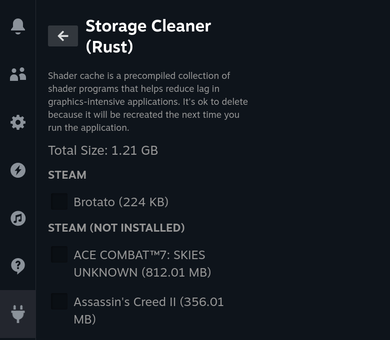
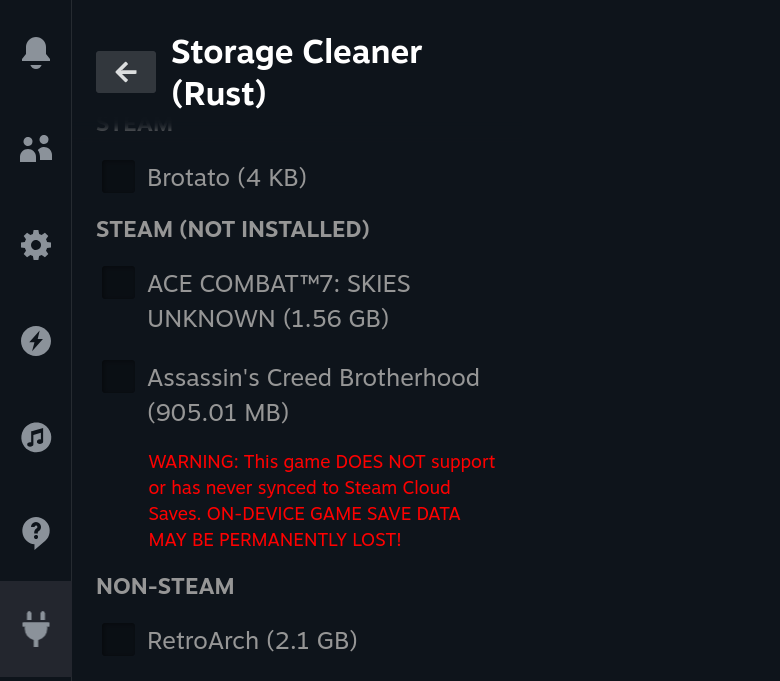
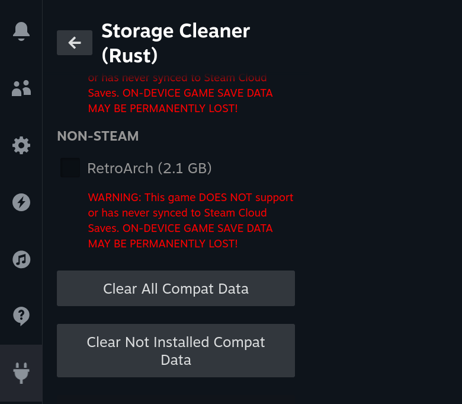

# Storage Cleaner (Rust) (Decky Loader Plugin)

Storage Cleaner (Rust) shows how much space each game's **shader cache** and **compatibility data** use on your Steam Deck, and lets you clear them. This can free a lot of the "Other" storage that Steam shows.

- **Shader cache** is graphics data that a game builds the first time it runs. If you delete it, Steam builds it again, so the game can stutter a little the next time you play it.
- **Compatibility data** is the Windows environment (Proton "prefix") that Steam makes for each Windows game. If you delete it, Steam makes it again. **Some games keep their save files here.** If a game does not use Steam Cloud saves, deleting its compatibility data can delete your saves. The plugin shows a red warning for these games.

This is a port of Matt Carlucci's [Storage Cleaner](https://github.com/mcarlucci/decky-storage-cleaner) with a fast native backend. It works with the standard [Decky Loader](https://decky.xyz/) and with the Rust edition of Decky Loader. It is a separate plugin: if you have the original Storage Cleaner, uninstall it first so that you do not have two copies in the menu.

  
  
  

## Install

1. Install [Decky Loader](https://decky.xyz/) on your Steam Deck, if you do not have it yet.
2. If the original **Storage Cleaner** is installed, uninstall it: in the Decky settings (gear icon), open **Plugins**, find Storage Cleaner, and select **Uninstall**.
3. On the Steam Deck, open the [latest release](https://github.com/beallio/decky-storage-cleaner-rust/releases/latest) and download `decky-storage-cleaner-rust.zip`.
4. Press the Quick Access button (`…`), open the Decky tab (plug icon), and select the gear icon.
5. In **General**, turn on **Developer mode**. Then open **Developer** and select **Install Plugin from ZIP File**. Choose the file that you downloaded.

## Use

1. Press the Quick Access button, open the Decky tab, and select **Storage Cleaner (Rust)**.
2. Each section shows the total size and a list of games, with the size of each game. Games are in three groups: **STEAM** (installed Steam games), **STEAM (NOT INSTALLED)** (data left behind by Steam games that you uninstalled), and **NON-STEAM** (shortcuts that you added to Steam).
3. Select games and press **Clear Selected**, press **Clear Not Installed** to clear only the games in the "not installed" group, or press **Clear All** to clear every game in the list. Each action asks you to confirm before it deletes anything.

Only games that Steam knows by name are listed, so only those are cleared. Compatibility data of a game that is not installed can still hold your saves; check the red warnings before you clear it.

## Troubleshooting

- **A game is not in the list:** Steam does not know a name for that folder (for example, an uninstalled non-Steam shortcut). The plugin does not touch these folders.
- **"Could not clear" message:** the message shows the reason for each game, for example a folder that was not a normal folder or a file that the plugin had no permission to delete.
- **The list stays empty or keeps loading:** restart Steam, or reinstall the plugin.
- **Two Storage Cleaner entries in the Decky menu:** the original plugin is still installed. Uninstall the one without "(Rust)".

## Credits

Original plugin by [Matt Carlucci](https://github.com/mcarlucci/decky-storage-cleaner). Native port by [beallio](https://github.com/beallio). Developer notes are in [DEVELOPMENT.md](DEVELOPMENT.md).
